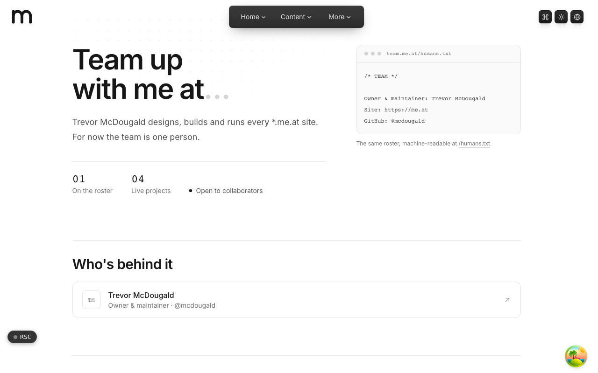
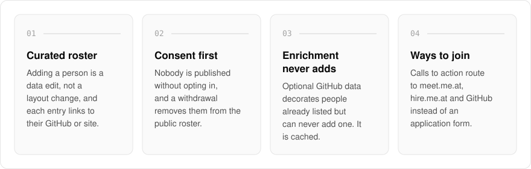
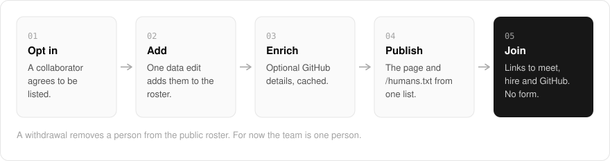

  <picture>
    <source media="(prefers-color-scheme: dark)" srcset=".github/assets/hero-dark.png">
    
  </picture>

<h1 align="center">team.me.at</h1>

<strong>Team up with me at... the people who build alongside me.</strong>

  
  
  

  <a href="https://team.me.at">Website</a> ·
  <a href="#features">Features</a> ·
  <a href="#how-it-works">How it works</a> ·
  <a href="#built-with">Built with</a>

If you want to build something with me, you should be able to see who already does and where to start. I built team.me.at as the collaborator and open-source team hub for my `*.me.at` family: a curated, consent-gated roster of collaborators and contributors, and calls to action that route anyone who wants to join toward the right existing channel. It is deliberately separate from hiring and scheduling, with no applicant workflow and no user input. For now the team is one person.

  <picture>
    <source media="(prefers-color-scheme: dark)" srcset=".github/assets/overview-dark.svg">
    
  </picture>

## Why

- **Consent before publication**: nobody appears on the roster without opting in, and a withdrawal takes them off it.
- **Curated, not scraped**: membership comes only from the roster itself. GitHub data can decorate a listed person but never add one.
- **No form to fill in**: joining means a link to an existing channel, not an applicant workflow.

## Features

- **Curated roster**: adding a person is a data edit, not a layout change, and each entry links to their GitHub profile or site.
- **Consent first**: a person must opt in before being published, and a withdrawal removes them from the public roster.
- **Optional GitHub enrichment**: when enabled, GitHub data can decorate people already on the roster but can never add membership. It is cached and degrades gracefully when unavailable.
- **Machine-readable roster**: the same team is published as `/humans.txt`.
- **Ways to join**: calls to action route to meet.me.at, hire.me.at and GitHub instead of a form.
- **Live projects at a glance**: a short list of the family projects the team works on.

## How it works

  <picture>
    <source media="(prefers-color-scheme: dark)" srcset=".github/assets/flow-dark.svg">
    
  </picture>

A collaborator opts in, and one data edit adds them to the roster. If enrichment is switched on, cached GitHub details decorate the people already listed. The same list is published as the page and as `/humans.txt`, and anyone who wants to join is pointed to meet.me.at, hire.me.at or GitHub.

## Built with

  
  
  
  
  

- Next.js 16 (App Router), React 19, TypeScript
- Tailwind CSS 4
- GitHub API (Octokit) for optional roster enrichment
- No app-owned backend

## Part of the me.at family

team.me.at is one of my [`*.me.at`](https://me.at) apps. They share one design system, account, and app shell. Development happens in a private monorepo; this repository is the project's public-facing home.

## License

Source-available. See [LICENSE](LICENSE).
